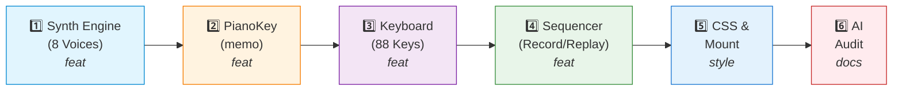

# WBS - Lab 3 Homework 2: 88-Key Polyphonic Piano

**Objective:** Build an 88-key polyphonic piano generated algorithmically via MIDI, supporting polyphony (8 voices) with FIFO voice stealing, and a variable-speed record/playback sequencer.

## Task Breakdown

| Task ID | Description | Commit Message | File(s) |
|---|---|---|---|
| HW2-00 | Init rules & WBS | `chore(hw2): init project rules and WBS` | `project-rules.md`, `TASK_DECOMPOSITION.md` |
| HW2-01 | Scaffold Vite React 19 | `chore(hw2): scaffold vite react 19 project` | `package.json`, `src/main.jsx` |
| HW2-02 | PolyphonicSynth (FIFO voice stealing) | `feat(hw2): implement polyphonic synth with fifo voice stealing` | `src/audio/PolyphonicSynth.js` |
| HW2-03 | Memoized PianoKey Component | `feat(hw2): create memoized piano key component` | `src/components/PianoKey.jsx` |
| HW2-04 | PianoKeyboard (88 keys generator) | `feat(hw2): generate 88 keys algorithmically` | `src/components/PianoKeyboard.jsx` |
| HW2-05 | Sequencer (Record & Replay 0.5x-2x) | `feat(hw2): implement fifo sequencer with playback speed` | `src/components/Sequencer.jsx` |
| HW2-06 | CSS Modules & Layout | `style(hw2): add responsive piano layout` | `src/components/Piano.module.css` |
| HW2-07 | Mount in App | `feat(hw2): mount piano in app` | `src/App.jsx` |
| HW2-08 | AI Failure Audit | `docs(audit): add ai failure mode audit report` | `AI_FAILURE_AUDIT.md` |

## Flow

## Acceptance Criteria

- □ Generate all 88 keys from MIDI 21 (A0) to 108 (C8). Formula: $f = 440 \times 2^{(\text{midi}-69)/12}$.
- □ 8 voices polyphony. The 9th key steals the oldest voice (FIFO).
- □ `PianoKey` uses `React.memo`. Pressing 1 key only re-renders that specific key (verify via Profiler).
- □ Include Record/Stop buttons. Replay supports 0.5x, 1.0x, and 2.0x playback speeds.
- □ Replay uses `AbortController` to cancel operations when Stop is clicked.
- □ Zero `
` soup, Zero `var`.
